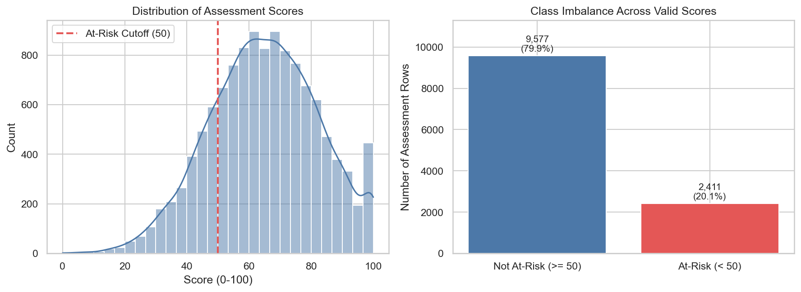
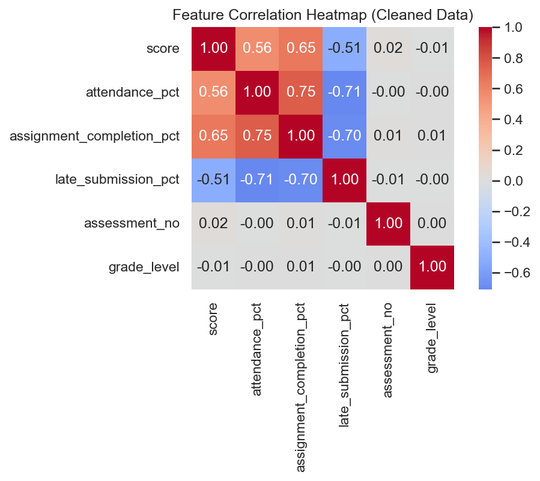
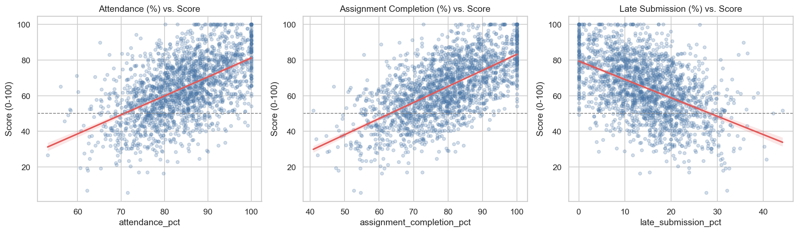
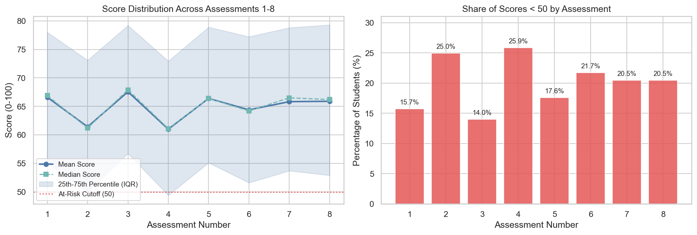
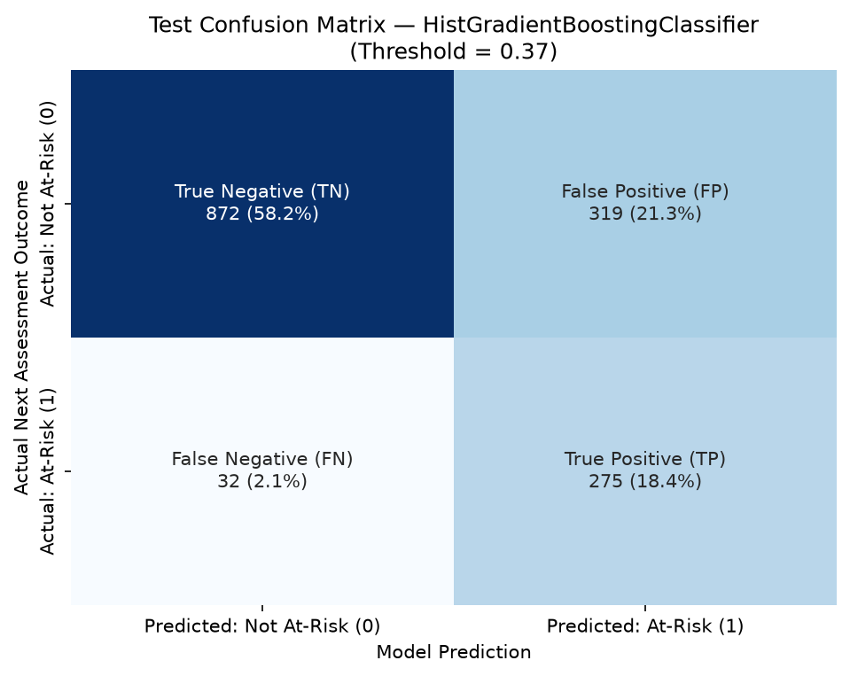
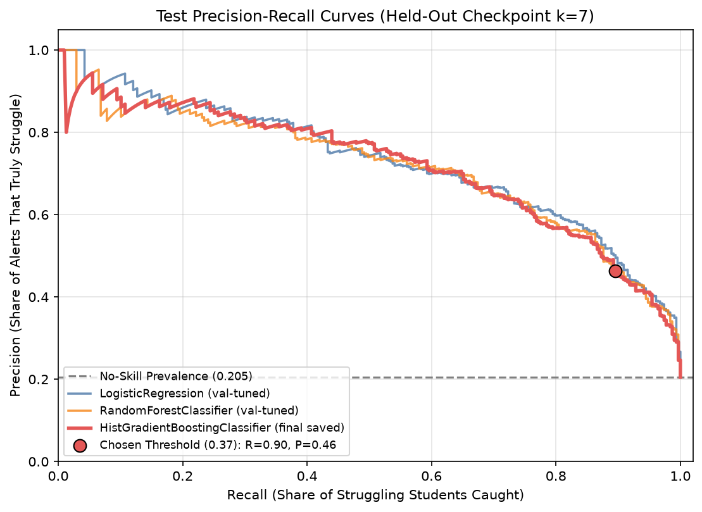
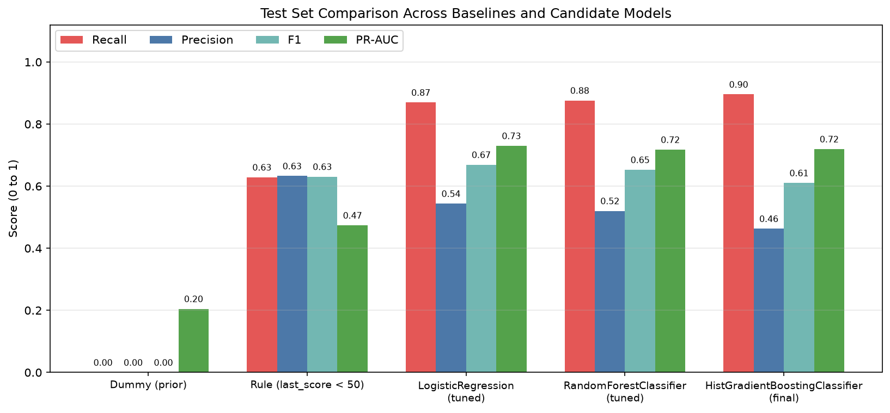
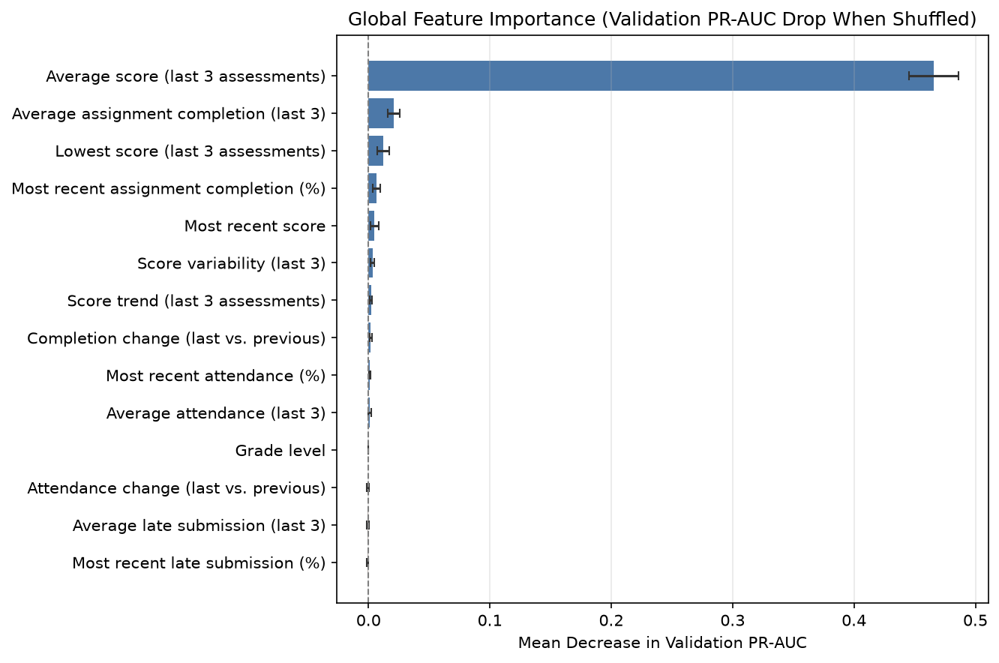

# Technical Report: Student Performance & At-Risk Prediction

**Project Status:** End-to-End Prototype Complete (`SEED = 42`, `scikit-learn 1.9.1`, `Python 3.11`)  
**Decision Boundary:** Strictly **advisory early-warning support** for teachers and school counselors — never automated grading, punishment, or admissions/placement gating.

---

## 1. Problem & Target Definition

- **Business Decision:** Every 2–3 weeks after an assessment cycle, educators decide which students should be offered proactive academic support (check-ins, tutoring, homework planning, or counselor outreach) before performance drops further.
- **Prediction Unit:** One student at assessment checkpoint $k$ ($k \in \{3, 4, 5, 6, 7\}$), built from historical observations across assessments $1 \dots k$.
- **Target Variable:** Binary indicator of whether the student's **next** assessment falls below the low-score cutoff (`LOW_SCORE_THRESHOLD = 50`):
  $$\text{low\_next\_score}_{k} = \mathbb{I}(\text{score}_{k+1} < 50)$$
- **Metric Alignment:** Because missing a struggling student (**False Negative**) leaves them without timely intervention—whereas offering an extra check-in to a student who ultimately passes (**False Positive**) carries low harm—recall and **F2** (recall-weighted) are prioritized alongside **Precision**, **F1**, **Confusion Matrix counts**, and **PR-AUC** (appropriate under ~20% class imbalance).
- **Primary Reference:** [Problem Definition](../docs/problem_definition.md)

> **[WRITE IN YOUR OWN WORDS]:** Explain in 2–4 sentences why a 2–3 week early-warning window at checkpoint $k$ is practical in a real school setting, and why framing this as "support triage" rather than "failure prediction" matters to students and teachers.

---

## 2. Data & Generator

Because real student records carry strict privacy constraints, this project uses a deterministic synthetic dataset generated by `src/data_generator.py` (`SEED = 42`). No real students or personally identifiable records exist in the repository.

- **Scale & Granularity:** `N_STUDENTS = 1500`, `N_ASSESSMENTS = 8` longitudinal assessments per student (`12,000` clean student-assessment pairs; `12,060` rows in `data/raw/students_raw.csv` after injecting `60` duplicate rows).
- **Raw Schema (9 columns):** `student_id`, `grade_level` (`8`, `9`, `10`), `gender` (`Female`, `Male`, `Non-binary` — audit only), `assessment_no` (`1..8`), `assessment_date`, `score` (`0–100`), `attendance_pct`, `assignment_completion_pct`, `late_submission_pct`.
- **Simulation Mechanics:**
  - Each student has latent **ability** and **effort** parameters plus a gradual longitudinal improvement/decline trend and per-assessment noise.
  - Effort and ability induce realistic correlations across assessment scores, attendance, assignment completion, and late submissions, calibrated so roughly ~20% of assessments score below `50`.
- **Intentional Quality Defects (Raw Dataset, `12,060` rows):**
  - Missing values: `attendance_pct` missing in `363` rows (`3.01%`), `assignment_completion_pct` missing in `241` rows (`2.00%`).
  - Out-of-range anomalies: `12` negative `score` values (`< 0`) and `12` impossible `attendance_pct` values (`> 100`).
  - Duplicates: `60` exact duplicate rows (`~0.5%`).

> **[WRITE IN YOUR OWN WORDS]:** Describe in your own words how latent student "ability", "effort", and time trends make this synthetic dataset more realistic than independent random numbers—and what real-world classroom patterns are still missing from a simulator.

---

## 3. EDA & Data Quality

Exploratory analysis and data quality verification live in `src/data_quality.py` and `notebooks/01_eda.ipynb`.

### Quality Cleaning (`clean_data()` in `src/data_quality.py`)
1. Exact duplicate rows are dropped (`12,060` $\rightarrow$ `12,000` rows).
2. Out-of-range values (`score` outside `[0, 100]` or percentage columns outside `[0, 100]`) are converted to `NaN`.
3. **No imputation is performed during cleaning.** Median imputation occurs strictly inside the `scikit-learn` `Pipeline` fitted on training data only to prevent data leakage.
4. Post-cleaning missingness across `12,000` rows: `score`: `12` (`0.10%`), `attendance_pct`: `372` (`3.10%`), `assignment_completion_pct`: `240` (`2.00%`).

### Key Exploratory Findings (`notebooks/01_eda.ipynb`)
- **Score Distribution (`11,988` valid cleaned scores):** Mean `64.89`, standard deviation `17.41`, median `65.00`; `20.11%` score below `50` across all assessments (`21.24%` across assessments `4..8`, corresponding to target checkpoints). *(On raw valid rows before duplicate removal, `20.10%` overall and `21.20%` on `4..8` were `< 50`.)*
- **Behavioral Correlations with `score` (Pearson $r$):**
  - `assignment_completion_pct`: `0.647`
  - `attendance_pct`: `0.556`
  - `late_submission_pct`: `-0.510`

| Score Distribution | Correlation Heatmap |
| :---: | :---: |
|  |  |

| Score Relationships | Score Trend Over Time |
| :---: | :---: |
|  |  |

> **[WRITE IN YOUR OWN WORDS]:** Summarize what stood out most to you in the EDA figures above (for example, the skew/spread of scores or how attendance and assignment completion relate to exam performance).

---

## 4. Feature List & Why Sensitive Attributes Are Excluded

Feature engineering is implemented once in `src/features.py` via `build_features(df)` (for batch training/evaluation) and `build_features_from_inputs(...)` (for the live Streamlit app), ensuring **zero training–serving skew**.

### Model Input Features (`FEATURE_COLUMNS`, 14 features total)

| Category | Feature Name | Definition (Using Only Assessments `1..k`) |
| :--- | :--- | :--- |
| **Scores** | `last_score` | Score at assessment $k$ |
| | `mean_score_last3` | Mean of last up to 3 valid scores ($\le k$) |
| | `score_std_last3` | Standard deviation of last up to 3 valid scores ($\le k$) |
| | `min_score_last3` | Minimum of last up to 3 valid scores ($\le k$) |
| | `score_slope_last3` | Linear trend slope over last up to 3 valid scores ($\le k$) |
| **Attendance** | `attendance_last` | Attendance % at assessment $k$ |
| | `attendance_mean_last3` | Mean attendance % over last up to 3 assessments ($\le k$) |
| | `attendance_change` | `attendance_pct[k] - attendance_pct[k-1]` |
| **Assignments** | `completion_last` | Assignment completion % at assessment $k$ |
| | `completion_mean_last3` | Mean completion % over last up to 3 assessments ($\le k$) |
| | `completion_change` | `assignment_completion_pct[k] - assignment_completion_pct[k-1]` |
| **Timeliness** | `late_submission_last` | Late submission % at assessment $k$ |
| | `late_submission_mean_last3` | Mean late submission % over last up to 3 assessments ($\le k$) |
| **Context** | `grade_level` | Student grade (`8`, `9`, or `10`) |

### Excluded Identifiers & Sensitive Attributes
- `student_id` and `checkpoint_no` (`k`) remain in processed CSVs for splitting and error lookup, and are **strictly excluded** from `FEATURE_COLUMNS` (enforced by automated unit test in `tests/test_features.py`).
- `gender` is **never** passed to `FEATURE_COLUMNS` or any model pipeline; it is retained solely for post-hoc fairness auditing (`src/audit.py`).

> **[WRITE IN YOUR OWN WORDS]:** Explain in plain language why demographic attributes like `gender` must be excluded from model features even if they happened to improve accuracy slightly, yet why collecting them (safely) for post-hoc auditing is still necessary.

---

## 5. Leakage Analysis

A prediction pipeline leaks if information unavailable at checkpoint $k$ influences training features, preprocessing, threshold tuning, or evaluation:

1. **Future Target Leakage:** Using `score_{k+1}` or future attendance/completion inside checkpoint $k$ features would artificially inflate performance. Guarded by strictly slicing assessments $\le k$ in `src/features.py` and verified by `tests/test_features.py` (which mutates post-$k$ rows and asserts features at $k$ remain bit-for-bit identical).
2. **Preprocessing Leakage:** Fitting median imputation or feature scaling across the combined dataset leaks validation/test distributions into training. Guarded by placing `SimpleImputer(strategy="median")` (and `StandardScaler` where required) inside `scikit-learn` `Pipeline` objects fitted only on `train.csv`.
3. **Hyperparameter / Threshold Leakage:** Tuning hyperparameters or probability cutoffs on `test.csv` overfits the evaluation set. Guarded by choosing hyperparameters, decision threshold (`0.37`), and risk-band boundaries solely on `val.csv` (`k = 6`), then freezing `models/model.joblib` and `models/metadata.json` prior to single-pass test evaluation (`src/evaluate.py`).
4. **Random Row Splitting Across Same-Student Checkpoints:** Splitting `(student_id, k)` rows randomly would place a student's later assessment in training and earlier assessment in test. Prevented by the chronological split strategy below.

> **[WRITE IN YOUR OWN WORDS]:** Give a concrete example from school life of what "future leakage" would look like if a developer accidentally leaked assessment $k+1$ data into a weekly dashboard, and why those numbers would fail in production.

---

## 6. Split Strategy

`src/split.py` drops rows where `score_{k+1}` is missing (`8` checkpoint rows skipped out of `7,500`, yielding `7,492` labeled rows) and partitions checkpoints **chronologically** by `checkpoint_no` (`k`):

| Split | Checkpoints (`k`) | Rows | At-Risk Rate (`low_next_score = 1`) | Purpose |
| :--- | :--- | :---: | :---: | :--- |
| **Train** | `k = 3, 4, 5` | `4,498` | `21.74%` | Fit imputer, scaler, and classifier weights |
| **Validation** | `k = 6` | `1,496` | `20.45%` | Tune hyperparameters, F2 threshold (`0.37`), and risk bands |
| **Test** | `k = 7` | `1,498` | `20.49%` (`307` pos / `1,191` neg) | Frozen single-pass unbiased evaluation |

Strict chronological ordering (`max(train.k) < min(val.k) <= max(val.k) < min(test.k)`) is verified by `tests/test_split.py`.

> **[WRITE IN YOUR OWN WORDS]:** Why did we split chronologically by checkpoint (`Train: k=3,4,5`, `Val: k=6`, `Test: k=7`) instead of using standard `train_test_split(..., random_state=42)`? Mention both temporal realism (predicting the future from the past) and repeated-student leakage.

---

## 7. Baselines & Models

In `src/train.py`, two interpretable baselines and three candidate model families (each wrapped in a `Pipeline` with median imputation) were trained on `train.csv` and compared on `val.csv`:

1. **Baseline A — `DummyClassifier(strategy="prior")`:** Always predicts the majority class (`0`), yielding zero recall and `PR-AUC = 0.2049` (positive base rate) on test.
2. **Baseline B — Domain Rule (`last_score < 50`):** Flags a student if and only if their most recent score was below `50`. Simple and interpretable, but misses students trending downward from `50–65`.
3. **`LogisticRegression(class_weight="balanced")`:** Linear classifier preceded by `SimpleImputer(strategy="median")` + `StandardScaler` (`val`-tuned F2 threshold: `0.51`).
4. **`RandomForestClassifier(class_weight="balanced")`:** Bagged decision trees preceded by `SimpleImputer(strategy="median")` (`val`-tuned F2 threshold: `0.45`).
5. **`HistGradientBoostingClassifier` (Selected Final Model):** Gradient-boosted trees with native missing-value handling alongside `SimpleImputer(strategy="median")`. Selected on validation performance with winning parameters `{'learning_rate': 0.03, 'max_depth': 3, 'min_samples_leaf': 20, 'class_weight': 'balanced'}`, validation-tuned F2 decision threshold **`0.37`**, and risk-band cutoffs **`Low < 0.37`**, **`Medium 0.37–0.76`**, **`High >= 0.76`**.
   - **Validation Risk-Band Calibration (`n = 1,496`):**
     - `Low` (`861` students, `57.55%`): actual at-risk rate **`1.97%`**
     - `Medium` (`345` students, `23.06%`): actual at-risk rate **`24.35%`**
     - `High` (`290` students, `19.39%`): actual at-risk rate **`70.69%`**

> **[WRITE IN YOUR OWN WORDS]:** Why is it valuable to test both simple baselines (`Dummy` and `last_score < 50`) before building tree-based models, and why did we define Low / Medium / High risk bands instead of showing only a Yes/No flag?

---

## 8. Metrics & Business Interpretation

The table below reports held-out **`test.csv` (`k = 7`, `n = 1,498`, `307` actual at-risk = `20.49%`)** performance read directly from `reports/metrics.json` after freezing all validation choices (`threshold` per candidate comes from validation F2 tuning and was never re-tuned on test):

| Model | Threshold | Precision | Recall | F1 | F2 | PR-AUC | TN | FP | FN | TP |
| :--- | :---: | :---: | :---: | :---: | :---: | :---: | :---: | :---: | :---: | :---: |
| **Baseline A: Dummy (prior)** | `0.50` | `0.0000` | `0.0000` | `0.0000` | `0.0000` | `0.2049` | `1191` | `0` | `307` | `0` |
| **Baseline B: Rule (`last_score < 50`)** | `0.50` | `0.6328` | `0.6287` | `0.6307` | `0.6295` | `0.4739` | `1079` | `112` | `114` | `193` |
| **LogisticRegression (val-tuned)** | `0.51` | `0.5438` | `0.8697` | `0.6692` | `0.7766` | `0.7301` | `967` | `224` | `40` | `267` |
| **RandomForestClassifier (val-tuned)** | `0.45` | `0.5203` | `0.8762` | `0.6529` | `0.7708` | `0.7177` | `943` | `248` | `38` | `269` |
| **HistGradientBoostingClassifier (final saved)** | `0.37` | `0.4630` | `0.8958` | `0.6104` | `0.7547` | `0.7195` | `872` | `319` | `32` | `275` |

### Key Interpretation
- **Huge Recall Gain Over Heuristic Rule:** The simple `last_score < 50` rule misses `114` struggling students (`Recall = 62.87%`). Our saved `HistGradientBoostingClassifier` reduces missed students to `32` (`Recall = 89.58%`, catching `275 / 307` at-risk students), nearly tripling precision-recall separation (`PR-AUC = 0.7195` vs `0.4739`).
- **Precision vs. Workload Trade-Off:** Flagging at threshold `0.37` generates `594` total alerts (`275 TP + 319 FP`, `Precision = 46.30%`), meaning roughly **1 in 2.2** flagged students genuinely needs intervention, while `High`-band filtering (`>= 0.76`) concentrates alerts on the highest-risk tier (`70.69%` actual rate on validation).
- **Honest Model Comparison Note:** Although `HistGradientBoostingClassifier` won validation selection and achieved the highest test recall (`89.58%`), `LogisticRegression` achieved slightly higher held-out test `F2` (`0.7766`) and `PR-AUC` (`0.7301`) with fewer false positives (`224` vs `319`). Keeping the validation winner frozen protects test-set integrity; future iterations could revisit `LogisticRegression` on a fresh temporal validation split if counselor capacity favors fewer alerts.

| Test Confusion Matrix (`HistGradientBoosting`) | Test Precision–Recall Curve | Test Model Comparison |
| :---: | :---: | :---: |
|  |  |  |

> **[WRITE IN YOUR OWN WORDS]:** Put yourself in a school counselor's shoes: given `275` True Positives, `319` False Positives, and `32` False Negatives out of `1,498` students, do you think threshold `0.37` is well-calibrated for a real counseling team, or would you prioritize Medium vs. High band triage differently? Also comment on `LogisticRegression`'s strong test performance vs `HistGradientBoosting`.

---

## 9. Error Analysis (False Positives vs. False Negatives)

`src/evaluate.py` inspects test-set errors for the saved `HistGradientBoostingClassifier` (`TP = 275`, `FN = 32`, `FP = 319`):

### School Meaning of Errors
- **False Positive (`FP = 319`):** Model predicts at-risk (`>= 0.37`), student scores `>= 50` on the next assessment. **School impact:** student is offered supportive outreach or check-ins they may not strictly need. Safe only if outreach is low-stakes, encouraging, and non-stigmatizing.
- **False Negative (`FN = 32`):** Model predicts low risk (`< 0.37`), student unexpectedly scores `< 50` next assessment. **School impact:** a struggling student is **missed** by the alert queue, delaying help.

### Feature Profile: Missed Struggling Students (`FN`) vs. Caught Struggling Students (`TP`)

| Feature / Output | False Negatives Mean (`n = 32`) | True Positives Mean (`n = 275`) | Takeaway |
| :--- | :---: | :---: | :--- |
| `last_score` | `64.09` | `43.28` | Missed students looked solid on assessment $k$ |
| `mean_score_last3` | `65.55` | `44.55` | Average recent scores were comfortably above `50` |
| `min_score_last3` | `58.31` | `36.89` | Even their lowest recent mark stayed above `50` |
| `score_slope_last3` | `-2.38` | `-1.72` | **Steeper downward slope** among missed students |
| `attendance_last` | `85.10` | `76.33` | Higher attendance masked emerging difficulty |
| `completion_last` | `78.74` | `67.72` | Assignments still mostly submitted |
| `late_submission_last` | `14.98` | `21.35` | Fewer late flags than typical at-risk peers |
| `pred_proba` | `0.23` | `0.81` | Model saw healthy baseline numbers |

### Concrete Examples from `reports/metrics.json`
- **Illustrative False Negative (`STU_0442`, Grade 8):** `last_score = 67.3`, `mean_score_last3 = 74.97`, `score_slope_last3 = -10.35`, `attendance_last = 100.0%`, `completion_last = 98.5%`, `late_submission_last = 0.0%` $\rightarrow$ `pred_proba = 0.02`, yet `low_next_score = 1`. Strong historical scores and attendance completely masked a rapid `-10.35`-point slide.
- **Illustrative False Positive (`STU_0415`, Grade 8):** `last_score = 20.5`, `mean_score_last3 = 25.13`, `score_slope_last3 = -4.6`, `attendance_last = 72.2%`, `completion_last = 61.1%`, `late_submission_last = 23.7%` $\rightarrow$ `pred_proba = 0.98`, yet `low_next_score = 0` (recovered to `>= 50` on the next assessment, e.g., via luck, turnaround effort, or noise).

> **[WRITE IN YOUR OWN WORDS]:** Looking at `STU_0442` and the FN-vs-TP comparison table, why are sharp downward slides from `65–75` (`FN`) hardest for any tabular model to catch, and how can teachers help spot those students even when the model marks them Low risk?

---

## 10. Explainability

Both global and single-student explanations live in `src/explain.py`:

### Global Permutation Importance (Validation Set `k = 6`, `reports/feature_importance.csv`)
Permutation importance measures how much validation PR-AUC drops when one feature column is randomly shuffled across students while keeping other features intact:

1. `mean_score_last3`: **`0.4658 ± 0.0204`** (dominant predictor by far)
2. `completion_mean_last3`: **`0.0208 ± 0.0051`**
3. `min_score_last3`: **`0.0121 ± 0.0050`**
4. `completion_last`: **`0.0065 ± 0.0030`**
5. `last_score`: **`0.0049 ± 0.0035`**
6. `score_std_last3`: **`0.0032`**, `score_slope_last3`: **`0.0021`**, `completion_change`: **`0.0019`**, `attendance_last`: **`0.0010`**, `attendance_mean_last3`: **`0.0008`**
- Near-zero / slightly negative values (`grade_level: -0.0000`, `attendance_change: -0.0005`, `late_submission_mean_last3: -0.0006`, `late_submission_last: -0.0007`) indicate those features add negligible incremental signal once `mean_score_last3` and `completion_mean_last3` are known (note: collinear features share credit under single-feature permutation).

### Local Per-Student Explanation (`explain_prediction(model, row)`)
- **Method:** Model-agnostic baseline substitution. Each of the `14` features for a student row is individually replaced with the **training-set median**, and the change in predicted risk probability ($\Delta p = p_{\text{student}} - p_{\text{with feature at median}}$) is measured.
- **Output:** Returns the **top 3 factors increasing risk** ($\Delta p > 0$) and **top 3 protective factors reducing risk** ($\Delta p < 0$) in plain English inside `app/streamlit_app.py`.

> **[WRITE IN YOUR OWN WORDS]:** Explain why `mean_score_last3` dominates single-feature importance so heavily (`0.4658`), why correlated features like `attendance_last` can appear tiny in permutation importance even though attendance had $r = 0.556$ with scores in EDA, and what a counselor should remember about predictive vs. causal factors.

---

## 11. Bias, Privacy & Failure Modes

Post-hoc subgroup evaluation (`src/audit.py`, `reports/bias_audit.csv`) measures flagged rate, recall, and false-positive rate (FPR) on `test.csv` (`n = 1,498`) across synthetic `gender` and `grade_level`:

| Audit Group | Subgroup | Test Count (`n`) | Flagged Rate | Recall (TPR) | False Positive Rate (FPR) |
| :--- | :--- | :---: | :---: | :---: | :---: |
| **Gender (Audit Only)** | `Female` | `747` | `40.96%` (`0.4096`) | `89.31%` (`0.8931`) | `27.89%` (`0.2789`) |
| | `Male` | `682` | `39.88%` (`0.3988`) | `89.29%` (`0.8929`) | `27.12%` (`0.2712`) |
| | `Non-binary` | `69` | `23.19%` (`0.2319`) | `100.00%` (`1.0000`) | `13.11%` (`0.1311`) |
| **Grade Level** | `Grade 8` | `493` | `37.73%` (`0.3773`) | `88.24%` (`0.8824`) | `24.55%` (`0.2455`) |
| | `Grade 9` | `496` | `41.73%` (`0.4173`) | `85.85%` (`0.8585`) | `29.74%` (`0.2974`) |
| | `Grade 10` | `509` | `39.49%` (`0.3949`) | `94.95%` (`0.9495`) | `26.10%` (`0.2610`) |

### Fairness, Privacy & Failure Observations
- **Gender Parity (`Female` vs `Male`):** Virtually identical flagged rates (`40.96%` vs `39.88%`), recall (`89.31%` vs `89.29%`), and FPR (`27.89%` vs `27.12%`). The `Non-binary` slice (`n = 69`) is too small for narrow confidence bounds (`flagged = 23.19%`, `recall = 100.0%`), illustrating why small-subgroup metrics must be tracked across larger horizons rather than over-interpreted on one checkpoint.
- **Grade Level Variance:** `Grade 9` shows lower recall (`85.85%`) and slightly higher FPR (`29.74%`) compared to `Grade 10` (`Recall = 94.95%`, `FPR = 26.10%`), warranting ongoing subgroup threshold monitoring if deployed across distinct curricula.
- **Privacy Design:** No sensitive demographic attributes enter predictions (`FEATURE_COLUMNS`), no PII exists in the synthetic dataset, and deployment must store minimal student identifiers under school access controls.
- **Key Failure Modes:** Missing recent assessment scores (`NaN` imputed silently toward training median), sudden non-academic disruptions (illness/trauma not captured in logs), curriculum difficulty jumps between checkpoints, and automation bias (staff treating risk bands as verdicts rather than prompts for conversation).

> **[WRITE IN YOUR OWN WORDS]:** Discuss the biggest ethical or operational failure risk if this tool were deployed poorly in a real school, and explain what safeguards (like avoiding self-fulfilling prophecies or labeling students "at-risk" publicly) you would put in place.

---

## 12. Limitations & Human Oversight

### Core Limitations
1. **Synthetic Data Boundary:** Trained and evaluated solely on simulated records (`src/data_generator.py`); real school adoption requires re-training, missingness checks, and re-calibration on local historical data.
2. **Checkpoint Cold-Start (`k >= 3`):** Cannot score brand-new students lacking at least 3 prior assessments without leaning heavily on median imputation.
3. **False Alert Volume (`FP = 319`):** High-recall screening intentionally over-flags relative to `High`-band precision; school capacity governs whether teachers act first on `High >= 0.76` before reaching `Medium 0.37–0.76`.
4. **Correlation, Not Causation:** Elevated risk probabilities signal statistical risk based on past numbers—not root causes such as eyesight problems, anxiety, part-time work, or language barriers.

### Mandatory Human Oversight
- Both `app/streamlit_app.py` and `docs/problem_definition.md` enforce that this system is **advisory only**.
- Every score and explanation serves as a conversation starter for a qualified teacher or counselor, who verifies attendance, classroom context, and student well-being before deciding any supportive next step.

> **[WRITE IN YOUR OWN WORDS]:** Reflect on what you learned building an end-to-end ML project under strict leakage, testing (`pytest`), explainability, and human-oversight constraints—and what single improvement you would prioritize next if you had another two weeks.

---

## 13. Tools & Attribution

- **Language & Runtime:** Python `3.11` (`3.11.15`)
- **Core Libraries (`requirements.txt`):** `pandas`, `numpy`, `scikit-learn` (`1.9.1`), `matplotlib`, `seaborn`, `joblib`, `streamlit`, `pytest`, `jupyter`, `ipykernel`
- **Architecture & Verification:**
  - Modular source pipeline under `src/` (`config.py`, `data_generator.py`, `data_quality.py`, `features.py`, `split.py`, `train.py`, `evaluate.py`, `explain.py`, `audit.py`, `predict.py`)
  - Interactive UI under `app/streamlit_app.py` (two tabs: *Predict Student Risk* and *Model performance*)
  - Automated regression & anti-leakage test suite under `tests/` (`13` passing tests covering data determinism/cleaning, future leakage prevention, chronological splitting, artifact loading, missing inputs, and band boundaries)
- **Project Guardrails:** Built in alignment with `PROJECT_CONTEXT.md` and `docs/problem_definition.md`; AI coding assistance was used during development with all code, tests, metrics, and guardrails independently reviewed and verified.

> **[WRITE IN YOUR OWN WORDS]:** Add any personal acknowledgments (mentors, coursework, references) and briefly describe which parts of this engineering workflow were most challenging or rewarding to build and verify yourself.

